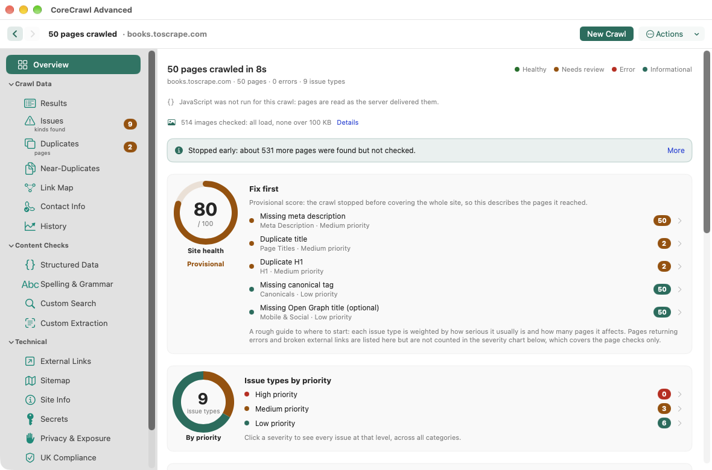
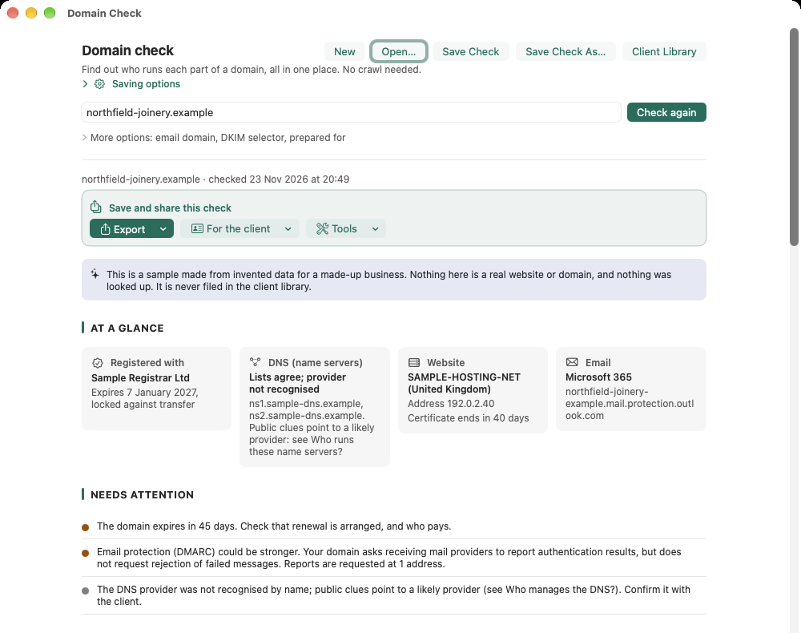

<h1> CoreCrawl Advanced</h1>

**Free, private website audits and domain checks for Mac.** CoreCrawl Advanced crawls your website and shows you what is broken, missing or holding it back: broken links, redirect chains, missing titles, repeated titles and descriptions, indexing problems and more. For anyone who looks after other people's sites, it also checks who runs a domain's registration, DNS, website and email, and keeps every client's checks together in a Client Library. It runs on your Mac. No account, no subscription, nothing locked behind a paywall.

### [Download CoreCrawl Advanced 3.0.0 (free)](https://github.com/tech-reality/CoreCrawl-Advanced-releases/releases/latest/download/CoreCrawl-Advanced.dmg)

For Apple silicon Macs (M1 or later), macOS 13 or later · by [Tech Reality](https://tech-reality.co.uk) · [Website](https://tech-reality.github.io/CoreCrawl-Advanced-releases/)

## For people who look after other people's sites

- **Domain Check:** who a domain is registered with, its expiry and transfer lock; who runs its DNS, website and email; SPF, DKIM and DMARC; the website certificate. It reads public records and cannot sign in to a registrar or DNS host, so who controls each account is for you and your client to confirm.
- **Client Library:** every finished Domain Check is filed under the client, one dated file per check, in a folder you choose. Website crawls can be filed beside them.
- **Renewals:** domain and certificate end dates for every client, soonest first, which you can save as a calendar file with a reminder two weeks before.
- **Client reports:** an A4 PDF report and client guide for each Domain Check, and a Client Health Pack that joins the domain and website reports. You can add your own business name and logo.

## What the website audit checks

- Broken links, redirect chains and server errors
- Titles, descriptions, headings and canonical tags
- Repeated titles and descriptions, and near-duplicate page text
- Orphan and weakly linked pages, with an interactive link map: spotlight problem pages, search for a page, see the route to it and preview it beside the map
- Accessibility, privacy and exposed-secrets checks
- UK cookie-consent and privacy-notice checks
- AI crawler access and `llms.txt`
- A health score and a "Fix first" list, with every finding explained in plain English
- A live Overview while it scans: a chart of how pages are turning out, running counts of problems and a progress bar
- Results you can narrow to OK, Redirects, Errors or pages with issues, with a preview of any page beside them

## Install

1. [Download `CoreCrawl-Advanced.dmg`](https://github.com/tech-reality/CoreCrawl-Advanced-releases/releases/latest/download/CoreCrawl-Advanced.dmg) and open it.
2. Drag **CoreCrawl Advanced** into your Applications folder.
3. The first time you open it, macOS says it cannot verify the app. That is because the app has not been through Apple's automatic security check for downloaded apps (notarisation), so macOS cannot verify it. The **How to Open CoreCrawl Advanced** guide inside the disk image shows every click. You only have to do it once.

To check the download is untouched, compare its SHA-256 checksum (in [this small file](https://github.com/tech-reality/CoreCrawl-Advanced-releases/releases/latest/download/CoreCrawl-Advanced.dmg.sha256.txt)) with the result of `shasum -a 256 CoreCrawl-Advanced.dmg`.

## Guides

- [User Guide](https://github.com/tech-reality/CoreCrawl-Advanced-releases/releases/latest/download/CoreCrawl-Advanced-User-Guide.pdf) (PDF, 35 pages): every tab, what the messages mean and what to do next
- [Start Here](https://github.com/tech-reality/CoreCrawl-Advanced-releases/releases/latest/download/START-HERE.pdf) (one page)

## Good to know

- By default it reads the HTML a site sends. Switch on **Render JavaScript** and it loads each page in a built-in browser first, so sites built in the browser are audited properly. That runs the site's own scripts, as a visitor would, so use it only on sites you own or have permission to test.
- Findings are prompts to take a look, not verdicts.
- Only audit sites you own or have permission to test.
- There is no Google Analytics or Search Console connection, and no page-speed testing. It is not a security scanner.
- Your results stay on your Mac. Nothing is uploaded to Tech Reality. The app contacts the website you audit, its links and images, and any optional checks you choose, such as a Domain Check of public records. If you keep your Client Library in a synced folder such as iCloud Drive or OneDrive, that provider syncs the files.
- A Domain Check is a set of public look-ups and one secure connection to the domain's own website. Its findings are prompts to confirm with the client, not proof of who holds an account.

## Licence and support

CoreCrawl Advanced is free to use for personal, business and client work, but it is not open source. Please do not re-upload, bundle or sell it; share [this page](https://github.com/tech-reality/CoreCrawl-Advanced-releases/releases/latest) instead. The full terms are in the [licence](https://github.com/tech-reality/CoreCrawl-Advanced-releases/releases/latest/download/CoreCrawl-Licence.txt), and the open-source software it contains is listed in the [third-party notices](https://github.com/tech-reality/CoreCrawl-Advanced-releases/releases/latest/download/Third-Party-Notices.txt).

Ideas, problems or questions? In the app choose **Help › Suggest a Feature or Report a Problem…**, or email [support@tech-reality.co.uk](mailto:support@tech-reality.co.uk). Nothing is sent from the app itself, and it never includes the websites you scan.

If CoreCrawl Advanced saves you time, there is an optional [coffee link](https://buymeacoffee.com/emq5t8mlml). There is no pressure.
